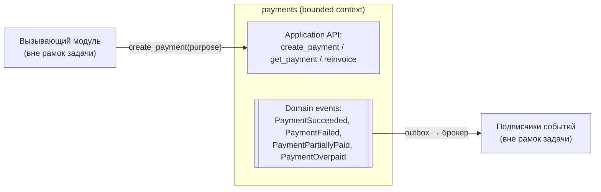
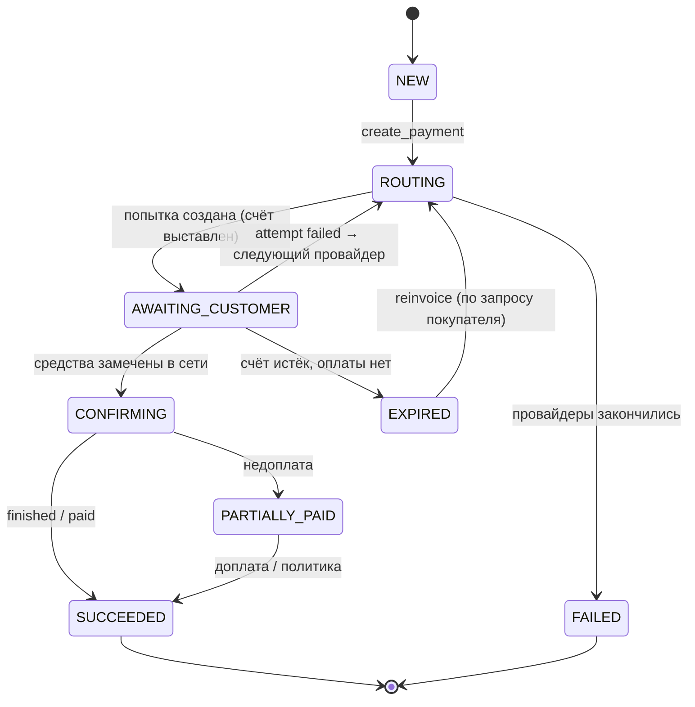
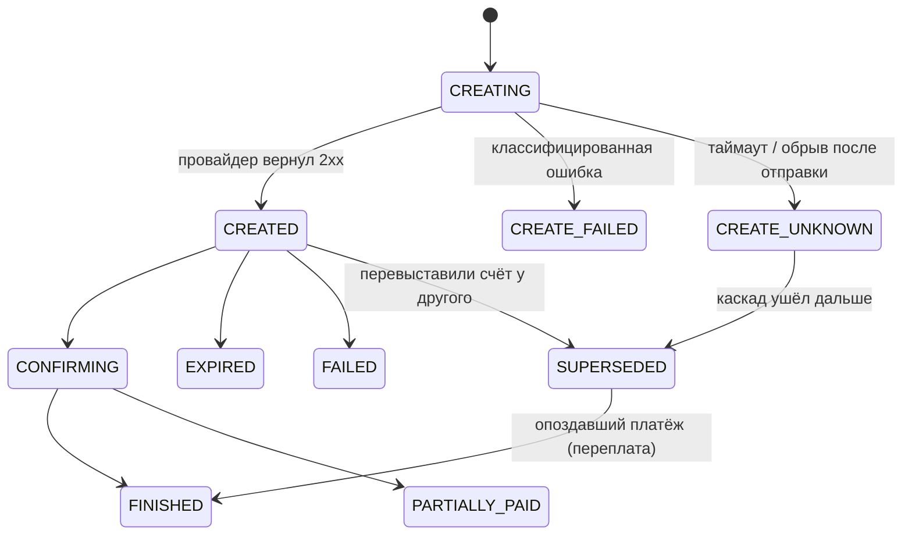
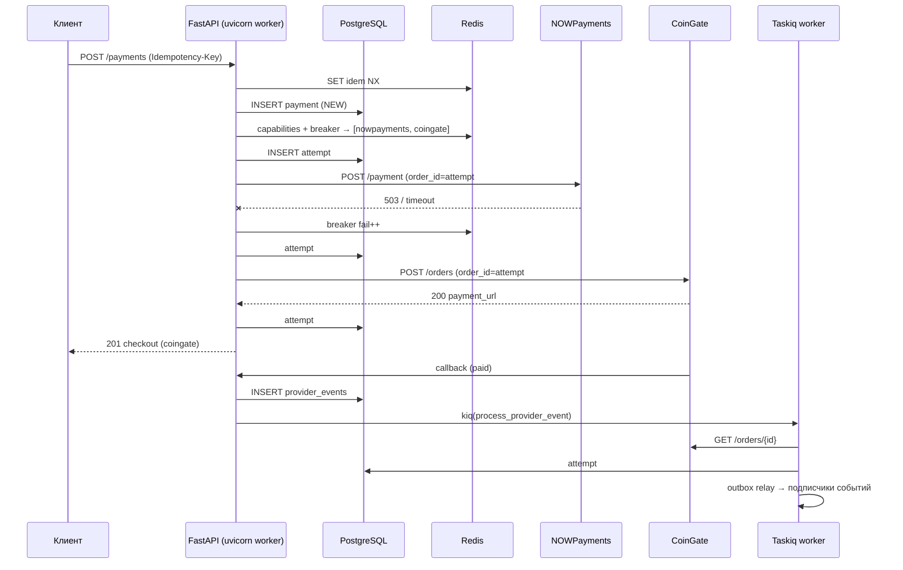

# 2. Техническое решение: каскадирование платежей

## 2.1. Цель и контекст

**Задача:** если платёж не удалось провести у одного провайдера, система сама переводит
его к следующему. При этом нельзя:
- потерять уже полученные деньги;
- списать или зачислить их дважды;
- заставлять покупателя заново проходить весь путь оплаты.

**Контекст заказчика:**
- высоконагруженная платформа, до 100 000 одновременных пользователей;
- модульный монолит на DDD / Clean Architecture с планом перехода на микросервисы;
- стек: Python 3.13, FastAPI, PostgreSQL, Redis, Taskiq, Docker, S3;
- NOWPayments уже используется.

### Цели
- Каскад между провайдерами с настраиваемым порядком и фильтрацией по возможностям провайдера.
- Корректная классификация ошибок: каскадируем только тогда, когда это безопасно.
- Идемпотентность на всех уровнях: клиент → API, API → провайдер, провайдер → вебхук.
- Деградация без участия людей: circuit breaker и обход «больного» провайдера.
- Независимость домена от провайдера и от транспорта (Taskiq/Redis или RabbitMQ).
- Наблюдаемость: видно, где и почему платёж ушёл по каскаду.

### Не цели
- Всё, что происходит после оплаты (выдача того, за что заплатили). Это ответственность
  внешних потребителей событий, и в задаче они не рассматриваются (см. 2.2).
- Возвраты (refund) и выплаты (payout). Для них оставлены точки расширения, но они не проектируются.
- Собственное хранение карточных данных (PCI DSS). См. 2.13.

### Анти-цели (решение провально, даже если «работает»)
- Повтор у другого провайдера при **неизвестном** исходе первой попытки, если это может
  привести к двойному списанию.
- Каскад по бизнес-отказу: невалидные данные, отказ по фроду, недоплата.
- Синхронное ожидание провайдера, которое держит соединения и воркеры, когда провайдеры деградируют.

---

## 2.2. Границы домена (bounded context)

`payments` — самостоятельный bounded context. Он знает про деньги, провайдеров и попытки
оплаты. Он **не знает**, что именно оплачивается.



Правила границы:
- Вход — только через application-сервисы модуля: `CreatePayment`, `GetPayment`, `Reinvoice`.
  Позже это станет HTTP/gRPC API отдельного сервиса.
- `purpose` — непрозрачная ссылка `{domain: str, ref: str}`. Платежи хранят её и возвращают
  в событиях, но не интерпретируют.
- Выход — только доменные события через transactional outbox. Что потребители делают с
  событием, модуль платежей не знает; от них требуется только идемпотентность по `payment_id`.
- Таблицы `payments` не читает никто извне. Общей БД-схемы у доменов нет, даже внутри монолита.
- Модуль лежит в отдельном пакете, и импортировать его внутренности запрещено. Это
  проверяется линтером, например `import-linter`.

Благодаря этому вынести модуль в отдельный микросервис — механическая работа: вызовы
application-сервисов меняются на HTTP-клиент, а outbox-relay начинает публиковать во внешний брокер.

---

## 2.3. Доменная модель

### Сущности (Pydantic-модели)

```python
class Money(BaseModel):           # value object
    amount: Decimal               # без float, quantize по валюте
    currency: str                 # ISO 4217 / тикер ("USD", "usdttrc20")

class Purpose(BaseModel):         # value object, непрозрачен для домена
    domain: str
    ref: str

class Payment(BaseModel):         # агрегат
    id: UUID
    user_id: UUID
    price: Money                  # что должны заплатить (фиат)
    pay_currency: str             # чем платят (монета)
    purpose: Purpose
    method: PaymentMethod         # CRYPTO | CARD
    status: PaymentStatus
    attempts: list[PaymentAttempt]
    received_total: Money         # сколько реально получено по всем попыткам
    idempotency_key: str
    version: int                  # optimistic locking

class PaymentAttempt(BaseModel):  # сущность внутри агрегата
    id: UUID                      # уходит провайдеру как order_id
    seq: int                      # 1, 2, 3...
    provider: ProviderCode
    provider_payment_id: str | None
    status: AttemptStatus
    failure: AttemptFailure | None  # класс + код + сырое сообщение
    checkout: Checkout | None     # pay_address / invoice_url / expires_at
    received: Money | None
    created_at / updated_at / deadline_at
```

Инварианты агрегата `Payment` (проверяются в методах, а не в сервисах):
- одновременно может быть **не больше одной активной** попытки (`CREATED`/`AWAITING`/`CONFIRMING`);
- новая попытка возможна, только если предыдущая финальна или признана замещённой (`SUPERSEDED`);
- статусы меняются только вперёд, по таблице переходов. Устаревший вебхук не откатывает
  `FINISHED` обратно в `CONFIRMING`;
- `Payment` становится `SUCCEEDED` от **первой** успешной попытки. Каждая следующая
  успешная попытка порождает `PaymentOverpaid` и не меняет исход платежа.

### Машина состояний платежа



### Машина состояний попытки



---

## 2.4. Классификация ошибок — ядро каскада

Каждый адаптер провайдера переводит ответ провайдера в один из классов. Решение
«каскадировать или нет» принимает **домен** по классу ошибки, а не адаптер.

| Класс | Примеры | Решение каскада | Штраф breaker'у |
|---|---|---|---|
| `PROVIDER_UNAVAILABLE` | connect error, DNS, 502/503/504, 429 | **следующий провайдер** | да |
| `PROVIDER_ERROR` | 500 с телом об ошибке, невалидный JSON | **следующий провайдер** | да |
| `TIMEOUT_UNKNOWN` | read timeout после отправки запроса | крипта: **следующий** (см. ниже); карты: **стоп → сверка** | да |
| `UNSUPPORTED` | валюта не поддерживается, сумма ниже минимума | **следующий**, без штрафа | нет |
| `INVALID_REQUEST` | 400/422 из-за наших данных, 401/403 (ключи) | **стоп**, алерт: это наш баг или конфиг | нет |
| `CUSTOMER_FAILED` | статус `failed` у провайдера после выставления счёта | новая попытка у следующего провайдера | нет |
| `CUSTOMER_EXPIRED` | счёт истёк без оплаты | стоп; `reinvoice` по запросу покупателя | нет |
| `PARTIAL` | `partially_paid` | **стоп**; политика недоплаты | нет |
| `BUSINESS_DECLINE` (карты) | insufficient funds, stolen card, fraud | **стоп** | нет |
| `SOFT_DECLINE` (карты) | issuer unavailable, processing error | следующий провайдер | нет |

### Почему в крипте каскадировать после таймаута безопасно, а с картами нет

- **Крипта (push-платёж).** Деньги отправляет сам покупатель, и только на адрес, который
  мы ему **показали**. Если создание счёта у NOWPayments упало по таймауту, а у провайдера
  счёт всё-таки создался, покупатель этого адреса не видел. Такой «призрачный» счёт просто
  истечёт. Поэтому каскад на этапе создания счёта безопасен при любой ошибке. Попытка
  помечается `SUPERSEDED`, а сверка всё равно её проверит.
- **Карты (pull-платёж).** Таймаут при списании может означать, что деньги уже списаны.
  Повтор у другого провайдера приведёт к двойному списанию. Правило: `TIMEOUT_UNKNOWN`
  останавливает каскад, платёж уходит в `PENDING_VERIFICATION`, и сверка спрашивает
  провайдера по `order_id` (наш `attempt_id`). Только при ответе «платежа нет»
  каскад продолжается.

### Опоздавший платёж по замещённой попытке

Покупатель мог оплатить старый счёт, например, открыв его во второй вкладке. Тогда:
1. Вебхук или сверка приносит `finished` по попытке в статусе `SUPERSEDED`.
2. Если `Payment` ещё не `SUCCEEDED`, эта попытка становится успешной, а активная
   попытка отменяется (если провайдер это поддерживает) или помечается `SUPERSEDED`.
3. Если `Payment` уже `SUCCEEDED`, публикуется `PaymentOverpaid{payment_id, attempt_id, amount}`.
   Что делать с излишком (зачесть или вернуть), решает подписчик события или
   бизнес-политика, а не каскад. Деньги в любом случае не теряются, потому что
   `received_total` учитывает каждую попытку.

---

## 2.5. Маршрутизация (какой провайдер следующий)

```
candidates = route_config[method][pay_currency]          # упорядоченный список из конфига
  → filter(capabilities.supports(pay_currency))           # из кэша Redis
  → filter(capabilities.min_amount <= amount)             # из кэша Redis
  → filter(breaker.state != OPEN)                         # из Redis
  → exclude(уже испробованные в этом платеже)
  → sort(priority, затем score)                           # score = success_rate_5m, опционально комиссия
```

- **Конфиг маршрутов** хранится в Postgres (`cascade_routes`), кэшируется в Redis и
  меняется без деплоя. По умолчанию: `CRYPTO: [nowpayments, coingate]`,
  `CARD: [stripe, braintree]`.
- **Capabilities** (список монет и минимальные суммы) раз в 10 минут обновляет
  периодическая задача: `GET /currencies` и `GET /min-amount`. Ключи вида
  `pay:cap:{provider}` с TTL. Если кэш пуст, провайдер не исключается: лучше вызвать
  и получить `UNSUPPORTED`, чем отбросить его по ошибке.
- `RoutingStrategy` — порт с реализациями `PriorityStrategy` (по умолчанию) и
  `ScoreStrategy` (по успешности). На будущее можно добавить `WeightedStrategy` для
  A/B-распределения трафика.

---

## 2.6. Надёжность

### Таймауты и бюджет
- На каждого провайдера свой `httpx.AsyncClient` с пулом соединений и таймаутами
  `connect=2s, read=8s` (настраиваются через pydantic-settings).
- Весь каскад создания счёта ограничен **общим дедлайном** (по умолчанию 15 с). Перед
  каждой попыткой проверяется остаток бюджета. Если до следующей попытки не хватает
  минимального времени, продолжение уходит в фон (см. реализации).
- **Bulkhead:** `asyncio.Semaphore` на каждого провайдера внутри процесса плюс общий лимит
  в Redis. Медленный провайдер не может занять все соединения и задержать event loop
  остального приложения.

### Circuit breaker (в Redis, общий для всех инстансов)
- Скользящее окно 60 с: `INCR pay:cb:{provider}:{ok|fail}:{bucket}` с TTL.
- `CLOSED → OPEN`, если доля ошибок ≥ 50% при количестве вызовов ≥ 20.
  Учитываются только классы со штрафом из таблицы 2.4.
- `OPEN` длится 30 с, затем `HALF_OPEN`: пробные вызовы пропускает `SET pay:cb:{p}:probe NX EX 10`.
  Дополнительно периодически проверяется `GET /status`.
- При открытом breaker'е провайдер просто выпадает из списка кандидатов, а каскад сразу
  идёт к следующему, без ожидания таймаута.

### Идемпотентность
| Уровень | Механизм |
|---|---|
| Клиент → API | Заголовок `Idempotency-Key`. `UNIQUE(user_id, idempotency_key)` в `payments`. Параллельные дубли сериализует `SET pay:idem:{key} NX EX 60` в Redis. Повтор возвращает уже созданный платёж |
| API → провайдер | `order_id = attempt_id`. Повторное создание той же попытки не создаёт новую сущность у провайдера (если провайдер дедуплицирует) и в любом случае находится сверкой |
| Провайдер → вебхук | Inbox-таблица `provider_events` с `UNIQUE(provider, event_hash)`. Дубль подтверждается ответом 200 без повторной обработки |
| События → потребители | В событии есть `event_id`. Потребитель ведёт свою inbox-таблицу или использует идемпотентную операцию по `payment_id` |

### Конкурентность
Переходы состояния выполняются в транзакции с `SELECT ... FOR UPDATE` по `payments.id`
(или с optimistic `version`). Вебхук, сверка и каскад могут прийти одновременно, но
сериализуются на одном агрегате.

### Вебхуки
1. `POST /webhooks/{provider}`: сначала проверка подписи (NOWPayments — HMAC-SHA512 по
   `x-nowpayments-sig`, CoinGate — наш `token`). Затем сырое тело сохраняется в
   `provider_events`, сервер отвечает `200` и ставит задачу `process_provider_event`.
   На всё это меньше 50 мс.
2. Задача **не доверяет телу вебхука**: она запрашивает актуальный статус по API
   провайдера (`GET /payment/{id}`, `GET /orders/{id}`) и применяет к агрегату только его.
   Это защищает и от подделки, и от вебхуков, пришедших не по порядку.

### Сверка (reconciliation)
Периодическая задача (каждую минуту) выбирает попытки в нефинальных статусах, к которым
давно не было обращений (`CREATE_UNKNOWN`, `CREATED`, `CONFIRMING`, `SUPERSEDED` моложе
TTL счёта + 24 ч), опрашивает провайдера и применяет результат. Так закрываются потерянные
вебхуки, «призрачные» счета и опоздавшие платежи.

### Transactional outbox
Каждое изменение агрегата и запись события в `outbox` выполняются **в одной транзакции**.
Relay (задача Taskiq или отдельный процесс) читает outbox
(`FOR UPDATE SKIP LOCKED`), публикует события и проставляет `published_at`.
Гарантия доставки — at-least-once, поэтому потребители идемпотентны.

---

## 2.7. Структура модуля (Clean Architecture)

```
src/modules/payments/
├── domain/                    # чистый Python + Pydantic, без I/O
│   ├── entities.py            # Payment, PaymentAttempt
│   ├── value_objects.py       # Money, Purpose, Checkout, ProviderCode
│   ├── statuses.py            # enum'ы + таблицы допустимых переходов
│   ├── errors.py              # FailureClass, AttemptFailure
│   ├── policies.py            # CascadeDecisionPolicy, LatePaymentPolicy
│   └── events.py              # PaymentSucceeded, PaymentFailed, PaymentOverpaid, ...
├── application/
│   ├── ports.py               # PaymentProviderPort, PaymentRepository, UnitOfWork,
│   │                          # ProviderHealthPort, CapabilityCache, IdempotencyLock,
│   │                          # CascadeDispatcher, Clock
│   ├── routing.py             # Router + RoutingStrategy
│   ├── cascade.py             # CascadeOrchestrator: один шаг каскада
│   └── use_cases/             # create_payment, reinvoice, handle_provider_event,
│                              # reconcile_attempt, refresh_capabilities
├── infrastructure/
│   ├── providers/             # nowpayments.py, coingate.py, mock.py, stripe.py, braintree.py
│   ├── db/                    # SQLAlchemy-модели, репозитории, UoW, миграции Alembic
│   ├── redis/                 # circuit_breaker.py, capability_cache.py, idempotency.py
│   └── messaging/
│       ├── taskiq/            # реализация 1
│       └── rabbitmq/          # реализация 2
├── presentation/
│   ├── api.py                 # /api/v1/payments
│   ├── webhooks.py            # /webhooks/{provider}
│   └── schemas.py
└── container.py               # DI: сборка адаптеров по настройкам
```

### Порт провайдера

```python
class PaymentProviderPort(Protocol):
    code: ProviderCode
    method: PaymentMethod

    async def create(self, cmd: CreateProviderPayment) -> ProviderCreateResult: ...
    # CreateProviderPayment: attempt_id(=order_id), price, pay_currency, callback_url, deadline
    # ProviderCreateResult: provider_payment_id, checkout, raw  ИЛИ  raises ProviderFailure(cls, code)

    async def fetch(self, provider_payment_id: str | None, order_id: UUID) -> ProviderPaymentState: ...
    def parse_webhook(self, headers: Mapping[str, str], body: bytes) -> ProviderEventRef: ...
    async def capabilities(self) -> ProviderCapabilities: ...
    async def health(self) -> bool: ...
```

Адаптер отвечает за перевод статусов и ошибок провайдера в доменные `AttemptStatus` и
`FailureClass`. Это anti-corruption layer. Добавить провайдера — значит написать один
адаптер и одну строку в конфиге маршрута.

### Оркестратор — один шаг каскада

```python
async def run_step(payment_id: UUID, deadline: datetime) -> StepResult:
    async with uow:
        payment = await repo.get_for_update(payment_id)
        provider = router.next(payment)                  # None → payment.fail(NO_PROVIDER)
        attempt = payment.start_attempt(provider.code)   # инвариант: одна активная
        await uow.commit()                               # попытка сохранена ДО вызова провайдера

    try:
        result = await provider.create(cmd(attempt, deadline))
        outcome = AttemptSucceeded(result)
    except ProviderFailure as f:
        outcome = AttemptFailed(f.cls, f.code)
    health.record(provider.code, outcome)

    async with uow:
        payment = await repo.get_for_update(payment_id)
        decision = payment.apply_create_outcome(attempt.id, outcome)   # домен решает
        await uow.commit()                                             # + события в outbox
    return decision        # DONE | NEXT_PROVIDER | STOP | VERIFY
```

Одна и та же функция `run_step` используется в обеих реализациях. Различается только то,
**кто** и **как** вызывает следующий шаг: цикл в запросе или сообщение в очереди.

---

## 2.8. Хранение (PostgreSQL)

| Таблица | Ключевые поля | Индексы |
|---|---|---|
| `payments` | id, user_id, price_amount, price_currency, pay_currency, method, purpose_domain, purpose_ref, status, received_total, idempotency_key, version, timestamps | `UNIQUE(user_id, idempotency_key)`, `(status, updated_at)` |
| `payment_attempts` | id, payment_id, seq, provider, provider_payment_id, status, failure_class, failure_code, checkout jsonb, received_amount, deadline_at, timestamps | `UNIQUE(payment_id, seq)`, `UNIQUE(provider, provider_payment_id)`, частичный `(status, updated_at) WHERE status IN (нефинальные)` для сверки |
| `provider_events` (inbox) | id, provider, event_hash, provider_payment_id, raw jsonb, received_at, processed_at | `UNIQUE(provider, event_hash)` |
| `payments_outbox` | id, aggregate_id, event_type, payload jsonb, created_at, published_at | частичный `WHERE published_at IS NULL` |
| `cascade_routes` | method, pay_currency, providers text[], strategy, enabled | PK(method, pay_currency) |

- Суммы хранятся как `NUMERIC(36, 18)`: у криптовалют много знаков после запятой.
- `payment_attempts` и `provider_events` при росте партиционируются по месяцу.
- Миграции — Alembic, отдельная ветка/директория на модуль, чтобы при выносе в сервис
  забрать её целиком.

## 2.9. Redis — что и зачем

| Ключ | Назначение | TTL |
|---|---|---|
| `pay:cb:{provider}:*` | circuit breaker: окна ok/fail, состояние, probe | 60–120 с |
| `pay:cap:{provider}` | capabilities: монеты, минимальные суммы | 15 мин |
| `pay:sr:{provider}:{bucket}` | success rate для `ScoreStrategy` | 10 мин |
| `pay:idem:{user}:{key}` | замок от параллельных дублей | 60 с |
| `pay:rl:{user}` | rate limit на создание платежей | 60 с |

Redis — только **производное, восстанавливаемое** состояние. Если его потерять, каскад
временно работает без breaker'а и кэша, но деньги и статусы не страдают.

## 2.10. API

```
POST /api/v1/payments                 Idempotency-Key: <uuid>   (JWT)
{ "price": {"amount": "9.99", "currency": "USD"},
  "pay_currency": "usdttrc20",
  "method": "CRYPTO",
  "purpose": {"domain": "<вызывающий модуль>", "ref": "<id>"} }

201 → { "payment_id": "...", "status": "AWAITING_CUSTOMER",
        "attempt": { "provider": "coingate", "seq": 2,
                     "checkout": { "pay_address": "...", "pay_amount": "9.99",
                                   "invoice_url": "...", "expires_at": "..." } } }
202 → { "payment_id": "...", "status": "ROUTING" }    # каскад продолжается в фоне

GET  /api/v1/payments/{id}            # статус + активная попытка
POST /api/v1/payments/{id}/reinvoice  # новый счёт после EXPIRED/FAILED
POST /webhooks/nowpayments
POST /webhooks/coingate
```

Покупатель узнаёт о смене статуса из WebSocket/SSE-канала платформы или опросом
`GET /payments/{id}`. Модуль платежей только публикует событие, доставка до клиента —
не его ответственность.

---

## 2.11. Реализация 1 — синхронный каскад + Taskiq/Redis (текущий стек)



**Как работает:**
- Каскад создания счёта выполняется **прямо в запросе**, циклом `run_step` в пределах
  дедлайна. Создание криптосчёта — это 0,3–2 с на провайдера, поэтому даже 2–3 шага
  укладываются в обычный HTTP-запрос.
- Если бюджет кончился, а провайдеры ещё остались, API ставит `continue_cascade.kiq(payment_id)`
  и возвращает `202`.
- Задачи Taskiq:
  - `process_provider_event` — обработка вебхука;
  - `continue_cascade` — продолжение каскада в фоне;
  - `reconcile_attempts` — сверка, по расписанию каждую минуту;
  - `expire_stale` — закрытие истёкших счетов;
  - `refresh_capabilities` — обновление возможностей провайдеров, каждые 10 минут;
  - `relay_outbox` — публикация событий из outbox.
- Расписание — `TaskiqScheduler` с `LabelScheduleSource`. Он запускается **одним**
  экземпляром или с распределённым замком в Redis.
- Брокер — `taskiq-redis`. Берём брокер на Redis Streams с подтверждением доставки, а не
  `ListQueueBroker`: list-брокер теряет задачу, если воркер падает после её извлечения.
  Повторы — через `SimpleRetryMiddleware` с экспоненциальной паузой. Задачи, исчерпавшие
  попытки, записываются в таблицу `failed_tasks` и вызывают алерт.
- Последствия потери задачи сглажены: всё, что касается денег, лежит в Postgres, и сверка
  подберёт любую «зависшую» попытку.

**Плюсы:** нет новой инфраструктуры; клиент получает счёт в одном запросе; проще всего
отлаживать.
**Минусы:** под нагрузкой медленные провайдеры держат соединения API (это ограничивают
bulkhead и дедлайн); у Redis слабее гарантии доставки и нет встроенной DLQ и отложенных
повторов (компенсируется сверкой); масштабировать оркестрацию отдельно от API нельзя.

## 2.12. Реализация 2 — событийная на RabbitMQ

```mermaid
flowchart LR
    API[FastAPI] -- "INSERT payment + outbox<br/>(CascadeStepRequested)" --> PG[(PostgreSQL)]
    Relay[Outbox relay] -- publisher confirms --> X1{{payments.commands<br/>direct}}
    PG --> Relay
    X1 --> Q1[q.cascade.step]
    Q1 --> SW[CascadeStep worker<br/>run_step]
    SW -- "NEXT_PROVIDER" --> PG
    SW -- "nack / ошибка" --> DLX{{payments.retry}}
    DLX --> R1[q.retry.5s TTL] & R2[q.retry.30s TTL] & R3[q.retry.5m TTL]
    R1 & R2 & R3 -- "DLX → обратно" --> X1
    SW -- "> N попыток" --> DLQ[q.cascade.dlq]
    WH[Webhook endpoint] --> PG
    PG --> Relay
    X1 --> Q2[q.provider.event] --> EW[ProviderEvent worker]
    Relay --> X2{{payments.events<br/>topic}}
    X2 -- "payment.*" --> QC[очереди подписчиков<br/>(вне рамок задачи)]
```

**Как работает:**
- `POST /payments` делает в одной транзакции `INSERT payment` и `INSERT outbox`
  (`CascadeStepRequested`), после чего сразу возвращает `202`. Счёт клиент получает
  через WebSocket или опросом. Чтобы UX не отличался от реализации 1, можно ждать
  первый шаг до 3 с (long-poll).
- **Каждый шаг каскада — отдельное сообщение.** Воркер выполняет `run_step`. Если
  решение `NEXT_PROVIDER`, в той же транзакции он записывает в outbox следующий
  `CascadeStepRequested`. Проблему «записали в БД, но не отправили» снимает outbox.
- **Повторы** при сбоях самого воркера (БД недоступна и т.п.) идут через лестницу
  задержек: очереди с TTL и DLX 5 с → 30 с → 5 мин, затем `q.cascade.dlq` и алерт.
  Это повторы *шага*, а не провайдера: переход к другому провайдеру решает домен.
- **Гарантии доставки:**
  - quorum-очереди;
  - publisher confirms;
  - ручной `ack` после коммита в БД;
  - `prefetch_count` на воркер;
  - дедупликация по `message_id` во входной (inbox) таблице потребителя.
- **Доменные события** уходят в topic exchange `payments.events`. Каждый подписчик
  объявляет собственную очередь с нужными routing key.
  Это уже готовый контракт для будущих микросервисов.
- **Реализация на стеке:** команды — через `taskiq-aio-pika` (`AioPikaBroker`), тогда код
  задач из реализации 1 переиспользуется почти без изменений. События — через aio-pika
  напрямую из outbox relay: topic-маршрутизация Taskiq не нужна. Периодические задачи
  (сверка, capabilities) остаются на `TaskiqScheduler`.

**Плюсы:**
- API не ждёт провайдеров, поэтому выдерживает всплески;
- оркестрация масштабируется отдельно (число воркеров на очередь);
- надёжная доставка, DLQ и отложенные повторы «из коробки»;
- естественный переход к микросервисам.

**Минусы:**
- новый компонент инфраструктуры (кластер RabbitMQ, мониторинг);
- клиент ждёт счёт асинхронно;
- больше движущихся частей, сложнее локальная разработка и трассировка.

## 2.13. Сравнение и рекомендация

| Критерий | Реализация 1: Taskiq + Redis | Реализация 2: RabbitMQ |
|---|---|---|
| Новая инфраструктура | нет | RabbitMQ (кластер) |
| Время до счёта для клиента | 1 запрос (обычно < 3 с) | 202 + push / long-poll |
| Поведение при деградации провайдеров | держит соединения API (ограничено дедлайном и bulkhead) | API не затронут, растёт очередь |
| Гарантии доставки задач | слабее (Streams + ack), подстраховывает сверка | quorum + confirms + DLQ |
| Отложенные повторы | middleware в коде | TTL + DLX средствами брокера |
| Масштабирование оркестрации | вместе с API и воркерами Taskiq | отдельно, по очередям |
| Путь к микросервисам | нужно добавить брокер событий | контракт событий уже есть |
| Сложность | низкая | средняя |

**Переходить на реализацию 2**, когда произойдёт одно из событий:
- p99 создания платежа или занятость воркеров API начнут страдать при деградации провайдеров;
- появятся карточные провайдеры с 3DS и долгими ответами;
- начнётся вынос модулей в микросервисы.

Домен, application-слой, адаптеры провайдеров и схема БД **одинаковы** в обеих
реализациях. Переход сводится к замене реализации порта `CascadeDispatcher`
(«выполнить шаг сейчас» вместо «отправить сообщение») и смене брокера.

---

## 2.14. Наблюдаемость

- **Метрики (Prometheus):**
  - `payments_attempts_total{provider, outcome, failure_class}`;
  - `payments_cascade_depth` (гистограмма);
  - `payments_provider_latency_seconds{provider, op}`;
  - `payments_breaker_state{provider}`;
  - `payments_unreconciled_attempts`;
  - `payments_outbox_lag_seconds`;
  - `payments_overpaid_total`.
- **Логи:** структурированные, с `payment_id`, `attempt_id`, `provider`, `seq`. Сырой
  ответ провайдера логируется только с маскированием чувствительных полей.
- **Трейсинг:** OpenTelemetry, контекст передаётся через задачи Taskiq и заголовки AMQP.
- **Алерты:**
  - breaker в состоянии OPEN дольше 5 минут;
  - глубина каскада растёт (доля платежей с `seq > 1` выше 20%);
  - есть `INVALID_REQUEST` (почти всегда это конфиг или ключи);
  - отставание outbox;
  - сообщения в DLQ;
  - переплаты.

## 2.15. Безопасность

- Секреты (API-ключи, IPN secret, CoinGate token) хранятся в pydantic-settings и
  берутся из env или secret manager; в репозиторий не попадают.
- Подпись каждого вебхука проверяется, и **статус всегда перепроверяется по API**.
  Сумме и статусу из тела вебхука не доверяем.
- Опционально — allowlist IP провайдеров на ingress.
- JWT на пользовательских эндпоинтах; `user_id` берётся из токена, а не из тела запроса.
- Rate limit на создание платежей для каждого пользователя.
- Деньги только в `Decimal`, округление по правилам валюты, фиатная цена фиксируется
  на момент создания платежа.

## 2.17. Тестирование

| Уровень | Что |
|---|---|
| Unit (domain) | таблицы переходов, инварианты агрегата, `CascadeDecisionPolicy` на все классы ошибок, опоздавший платёж |
| Unit (application) | оркестратор с fake-провайдерами и fake-часами: бюджет, breaker, фильтрация |
| Контрактные | адаптеры против записанных ответов (respx) и периодически против реальных песочниц NOWPayments и CoinGate |
| Интеграционные | testcontainers (Postgres, Redis, RabbitMQ): идемпотентность, конкурентные вебхуки, outbox |
| Сценарные | D1–D7 из [01-providers.md](01-providers.md) с mock-провайдером в docker-compose |
| Нагрузочные | locust: всплеск создания платежей при «медленном» основном провайдере, проверка, что p99 остального API не деградирует |
